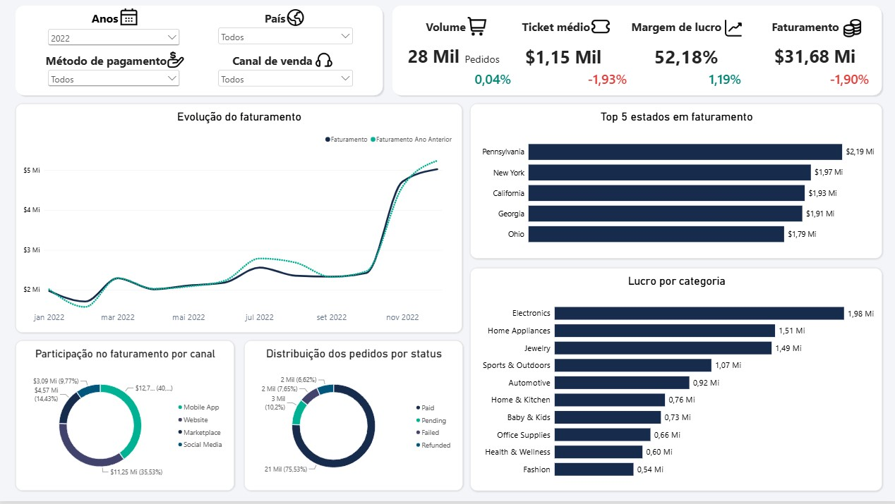
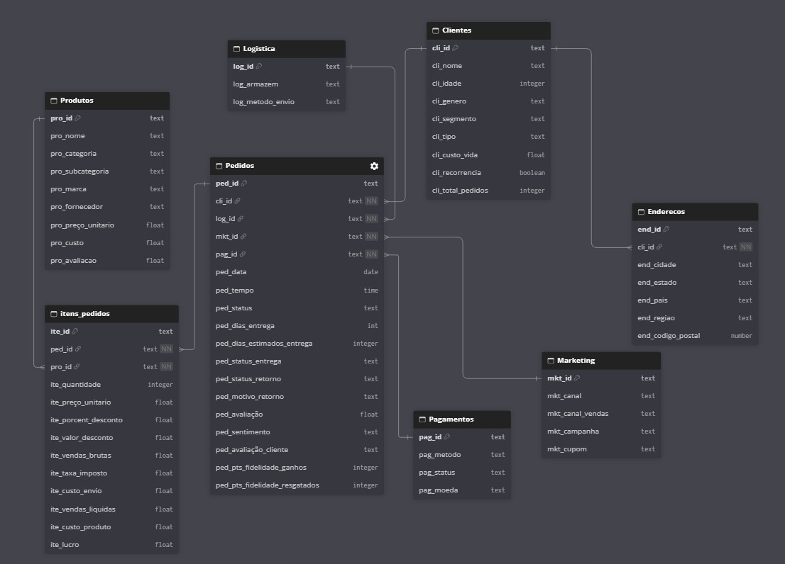

# 📊 Projeto de Análise de Dados — E-commerce



## 🎯 Objetivo do Projeto
Este projeto tem como objetivo estruturar um pipeline completo de análise de dados para uma operação de e-commerce (base fictícia extraída do Kaggle) — abrangendo desde a modelagem relacional do banco de dados e extração de métricas via **SQL** até a construção de um dashboard executivo interativo no **Power BI** com análise comparativa ano contra ano (*YoY* dinâmico, exibido automaticamente ao filtrar um ano específico).

O foco central é responder a perguntas estratégicas de negócio sobre faturamento, rentabilidade, comportamento de compra, recorrência de clientes e concentração de receita (Curva ABC / Pareto).

---

## 🛠️ Stack Tecnológica
* **Modelagem de Dados:** [dbdiagram.io](https://dbdiagram.io/) (Diagrama Entidade-Relacionamento)
* **Ingestão de Dados (ETL):** Python (Pandas, SQLAlchemy e PyMySQL) para leitura e carga automatizada dos CSVs no banco de dados
* **Banco de Dados & Consultas:** SQL (CTEs, Window Functions, Agregações e Joins)
* **ETL & Visualização de Dados:** Power BI (Power Query / DAX)
* **Versionamento:** Git & GitHub

---

## 🗂️ Fonte de Dados e Regras de Negócio
Os dados brutos utilizados neste estudo foram extraídos do dataset público **[E-Commerce Sales and Customer Analytics (Kaggle)](https://www.kaggle.com/datasets/datascikhan/e-commerce-sales-and-customer-analytics)**.

### Premissas e Tratamentos Aplicados:
1. **Integridade Financeira (Filtro de Status):** Para evitar distorções nos indicadores de receita, todas as análises financeiras em SQL e no Power BI consideram estritamente pedidos com status **`Paid`** (Pagos), descartando pedidos cancelados, pendentes ou estornados.
2. **Padronização Regional (ETL):** Tratamento de localidade e separadores decimais no Power Query para garantir precisão exata entre as agregações do banco de dados e os visuais do Power BI.
3. **Modelagem Relacional:** Estruturação em tabelas fato e dimensão (`clientes`, `pedidos`, `itens_pedidos`, `produtos`, etc.) garantindo integridade referencial via `INNER JOIN`.

### 📐 Arquitetura e Modelagem (DER)


---

## 🔍 Perguntas de Negócio & Principais Insights
Abaixo estão os questionamentos respondidos através das queries SQL (disponíveis e aprofundados na pasta `perguntas_de_negocio/`):

### 1. Qual é o volume total de faturamento bruto e o lucro total?
* **Resultado:** A operação atingiu um faturamento bruto validado de **US$ 158.390.939,65** considerando apenas pedidos pagos, com um lucro de **US$ 59.826.619,04**.
* **Análise:** A operação demonstra forte saúde financeira e geração de caixa consistente, convertendo quase 38% do faturamento bruto pago em lucro líquido, o que garante boa folga operacional para absorver custos logísticos e investimentos em marketing.

### 2. Quais são as 5 categorias de produtos com maior margem de lucro líquido?
* **Resultado:** Electronics, Jeweiry, Home Appliances, Sports & Outdoors, Automotive
* **Análise:** O lucro líquido concentra-se fortemente em categorias de maior valor agregado e bens duráveis (*Electronics*, *Jewelry* e *Home Appliances*), indicando que o ticket unitário elevado pesa mais na composição do lucro do que o alto giro de itens de baixo custo.

### 3. Qual combinação de canal de vendas e origem de aquisição gera maior volume e ticket médio?
* **Resultado:** A combinação **Moblibe App + Sem Campanha** lidera o volume de vendas líquidas com **US$ 34.714.444,43**, enquanto **Social Media + Promo_Email** apresenta o maior ticket médio (**US$ 1663,25**).
* **Análise:** O tráfego orgânico direto no aplicativo móvel sustenta o volume base da operação sem custo de mídia paga, enquanto campanhas combinadas de *Social Media* e *Email Marketing* funcionam como alavancas de *upsell*, atraindo compras de maior valor.

### 4. Como está a eficiência logística (prazo estimado vs. real e taxa de atraso) por estado?
* **Resultado:** Entre as regiões monitoradas, os maiores índices de atraso ocorrem em **Sharjah** (**16,45%** em 857 pedidos), **Tamil Nadu** (**15,88%** em 932 pedidos) e **Baden-Württemberg** (**15,77%** em 1.953 pedidos). Em volume absoluto de impacto, destacam-se **Pennsylvania** (**7.549 pedidos**, **15,47%** de atraso) e **California** (**7.019 pedidos**, **14,73%** de atraso).
* **Análise:** Enquanto regiões menores lideram a taxa percentual de atraso, estados de alto volume como Pennsylvania e California representam o maior risco operacional absoluto, devendo ser priorizados na renegociação logística.

### 5. Qual é a taxa de devolução, os principais motivos e o impacto financeiro na operação?
* **Resultado:** A taxa geral de devolução é de **6,84%**, gerando uma perda direta de **US$ 7.347.361,35** em lucro líquido. Os 3 principais motivos são: **Produto errado**, **Mudou de ideia** e **Outros**.
* **Análise:** O volume deixado na mesa ultrapassa US$ 7,3 milhões. Como o principal motivo é o envio de *Produto errado*, melhorias na conferência no centro de distribuição e descrições mais precisas nas páginas de produto podem estancar grande parte dessa perda.

### 6. Qual é a diferença de comportamento entre clientes recorrentes e novos clientes?
* **Resultado:** Clientes recorrentes representam **99,76%** do volume de pedidos, possuem ticket médio de **US$ 1380,95** (vs. **US$ 1436,14** de novos) e taxa de uso de cupom de **19,96%**(vs. **18,11%** de novos).
* **Análise:** O faturamento da empresa é altamente dependente da retenção da base atual, e a taxa equilibrada de uso de cupons (~20% em ambos os grupos) comprova que a recompra ocorre de forma orgânica e saudável, sem dependência de descontos agressivos.

### 7. O uso de cupons de desconto aumenta o volume de vendas ou apenas corrói a margem de lucro?
* **Resultado:** Pedidos com cupom apresentaram margem líquida de **41,62%**, contra **41,54%** nos pedidos sem cupom.
* **Análise:** A estratégia promocional atual é altamente sustentável: os pedidos com cupom mantêm a margem praticamente idêntica (0,08 superior) aos pedidos sem desconto, indicando que os cupons estão bem calibrados e atuam como estímulo à conversão sem corroer a rentabilidade.

### 8. Quem são os 3 principais clientes (VIPs) em faturamento líquido por estado?
* **Resultado:** Mapeamento do Top 3 clientes por unidade federativa (ex: em **Nova York**, os 3 maiores compradores somam **US$ 78.002,99**).
* **Análise:** A identificação nominal dos principais compradores regionais permite estruturar ações e programas de fidelidade VIP (frete grátis prioritário, acesso antecipado a lançamentos) para blindar essa receita contra a concorrência.

### 9. Como foi a evolução mensal do faturamento líquido (crescimento MoM)?
* **Resultado:** O faturamento apresentou variação média mensal (MoM) de **7,20%**, com pico de crescimento em **Novembro** (**+51,17%**) e maior retração em **Janeiro** (**-46,63%**).
* **Análise:** A operação apresenta forte sazonalidade de varejo: o salto expressivo de +51,17% em Novembro (compras de fim de ano) é seguido naturalmente pela ressaca de consumo em Janeiro (-46,63%), exigindo planejamento antecipado de estoque no 4º trimestre e campanhas de queima de estoque no início do ano.

### 10. Como está classificado o catálogo de produtos na Curva ABC de faturamento?
* **Resultado:** O catálogo foi segmentado nas faixas **Classe A (Essencial - Top 80%)**, **Classe B (80% a 95%)** e **Classe C (95% a 100%)**, tendo como principais líderes de receita os produtos **PROD-000065** (US$ 762.476,30), **PROD-000074** (US$ 720.203,77) e **PROD-000051** (US$ 704.379,86).
* **Análise:** A concentração da receita nos produtos Classe A exige política de estoque de segurança rigorosa (ruptura zero) para os líderes como o `PROD-000065`, enquanto os itens da Classe C devem passar por revisão de giro para evitar capital imobilizado.

---

## 💡 Recomendações Estratégicas
Com base nos dados analisados, sugere-se:

1. **Redução de Perdas Operacionais (Foco nos US$ 7,34M em Devoluções):**
   * **Ação:** Implementar dupla conferência automatizada e revisar especificações técnicas nas páginas dos produtos.
   * **Justificativa:** Como *"Produto errado"* é o principal motivo das devoluções (taxa geral de **6,84%**), corrigir falhas internas de expedição é a alavanca mais rápida para recuperar parte dos **US$ 7,34 milhões** perdidos em lucro líquido.

2. **Redução de Atrasos na entrega:**
   * **Ação:** Verificar com transportadoras o motivo dos atrasos nos polos de maior volume absoluto (**Pennsylvania** e **California**, que somam mais de 14.500 pedidos com atraso próximo a 15%) e ajustar o prazo estimado exibido no *checkout* para regiões com alto atraso relativo (**Sharjah**, **Tamil Nadu** e **Baden-Württemberg**, acima de 15,7%).
   * **Justificativa:** Mitiga o atrito com a base principal de clientes e reduz o impacto causado por expectativas de entrega frustradas.

3. **Gestão de Estoque Orientada à Curva ABC e Sazonalidade:**
   * **Ação:** Estabelecer um estoque de segurança reforçado para os produtos **Classe A** (especialmente os líderes **PROD-000065**, **PROD-000074** e **PROD-000051**) a partir de setembro, preparando a operação para o pico de **Novembro (+51,17% MoM)**, seguido de campanhas de liquidação para itens **Classe C** em **Janeiro (-46,63% MoM)**.
   * **Justificativa:** Garante disponibilidade nos itens que sustentam 80% da receita durante a alta temporada e evita capital parado na retração de início de ano.

4. **Expansão Controlada de Cupons para Aquisição:**
   * **Ação:** Manter as regras atuais de cupom de desconto (que preservam a margem líquida em **41,62%**) e criar cupons específicos de primeira compra para acelerar a entrada de novos clientes.
   * **Justificativa:** Como **99,76%** dos pedidos vêm de clientes recorrentes, a operação tem retenção exemplar, mas precisa aumentar a base com novos compradores sem sacrificar a rentabilidade.

---

## 📁 Estrutura do Repositório

```text
analise-dados-ecommerce
├── dados                   # Arquivos CSV brutos utilizados na carga do banco
├── dashboard               # Arquivo do projeto Power BI (.pbix / .pbit)
├── imagens                 # Capturas de tela do dashboard e do DER (dbdiagram.io)
├── perguntas_de_negocio    # Scripts SQL estruturados com CTEs para cada análise
└── README.md               # Documentação técnica e executiva do projeto